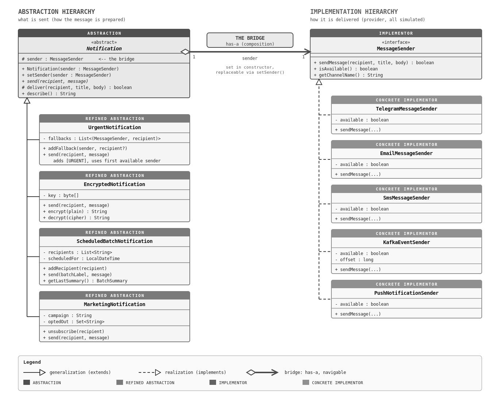

# Assignment 3 - Multi-Channel Notification Gateway (Bridge Pattern)

**Course:** Software Design Patterns
**Language:** Java JDK 17 (Temurin)
**Presenter:** Abdulla Nurdaulet

## Project Overview
A notification gateway that separates *what kind* of notification is sent (abstraction)
from *how* it is delivered (implementation) using the **Bridge** pattern.

Without Bridge, N types x M providers = N x M classes (`UrgentTelegramNotification`, `EncryptedSmsNotification`, ...).
With Bridge, the core design needs N + M classes rather than N × M combination classes.
Before the independent extensions, 3 notification types + 4 providers covered 12 combinations with 7 classes.
The final project adds `MarketingNotification` and `PushNotificationSender`: 4 types + 5 providers cover 20
combinations with 9 classes.

### Key Features
* **Abstraction (what):**
  * `UrgentNotification` - prepends `[URGENT]`, checks `isAvailable()`, switches to a fallback sender if the primary is down
  * `EncryptedNotification` - XOR + Base64 transformation before sending (demo only, not real cryptography)
  * `ScheduledBatchNotification` - sends to a collection of recipients and prints `Total / Successful / Failed`
  * `MarketingNotification` *(added later)* - `[PROMO]` campaign title, opt-out hint, skips unsubscribed recipients
* **Implementation (how)** - all simulated, each behaves differently:
  * `TelegramMessageSender` - Markdown message with bold title, 4096-char limit, `@username` recipient
  * `EmailMessageSender` - title becomes the subject, signature appended, address validated
  * `SmsMessageSender` - plain `title: body`, max 160 characters (truncated with a warning), phone number validated
  * `KafkaEventSender` - JSON event published to a topic with simulated partition/offset
  * `PushNotificationSender` *(added later, see Independent Extension)* - device token recipient, JSON payload up to 256 characters
* Any type works with any provider; the provider can be swapped at runtime (`setSender`)
* 4 types x 5 providers = 20 combinations covered by 4 + 5 concrete classes (not 20)

## UML Class Diagram



Vector version: [`docs/uml-class-diagram.svg`](docs/uml-class-diagram.svg).
The diagram marks every Bridge role (**Abstraction**, **Refined Abstraction**, **Implementor**,
**Concrete Implementor**) and the **bridge** itself: the red `has-a` arrow from `Notification` to `MessageSender`.

| Bridge role | Class |
|---|---|
| Abstraction | `Notification` |
| Refined Abstractions | `UrgentNotification`, `EncryptedNotification`, `ScheduledBatchNotification`, `MarketingNotification` |
| Implementor | `MessageSender` |
| Concrete Implementors | `TelegramMessageSender`, `EmailMessageSender`, `SmsMessageSender`, `KafkaEventSender`, `PushNotificationSender` |

## Project Structure
```
Assignment3/
├── pom.xml
├── src/main/java/
│   ├── Main.java
│   ├── ExtensionDemo.java
│   ├── notification/   (abstraction hierarchy)
│   │   ├── Notification.java
│   │   ├── UrgentNotification.java
│   │   ├── EncryptedNotification.java
│   │   ├── ScheduledBatchNotification.java
│   │   ├── MarketingNotification.java
│   │   └── BatchSummary.java
│   └── provider/       (implementation hierarchy)
│       ├── MessageSender.java
│       ├── TelegramMessageSender.java
│       ├── EmailMessageSender.java
│       ├── SmsMessageSender.java
│       ├── KafkaEventSender.java
│       └── PushNotificationSender.java
├── src/test/java/
│   ├── NotificationBridgeTest.java
│   ├── SenderTest.java
│   ├── RecordingSender.java   (test double)
│   └── OutputCapture.java
├── docs/
│   ├── uml-class-diagram.png
│   └── uml-class-diagram.svg
├── README.md
└── REPORT.md
```

## How to Run
```bash
mkdir -p out
javac -d out $(find src/main/java -name "*.java")
java -cp out Main            # the six mandatory demo scenarios
java -cp out ExtensionDemo   # extra: new provider / new type in more combinations
```

Run the unit tests (JUnit 5, requires Maven):
```bash
mvn test
```
Or run `Main` directly from IntelliJ.

## Bridge Pattern - Short Answers

**1. What are the two independent dimensions?**
(a) The *notification type* - how a message is prepared: urgent, encrypted, scheduled batch, marketing.
(b) The *delivery provider* - how it is transported: Telegram, Email, SMS, Kafka, Push.
Either one can change without touching the other.

**2. Where exactly is the Bridge?**
In the field `protected MessageSender sender` of `Notification` (set in the constructor and replaceable with `setSender`).
This single has-a reference connects the abstraction hierarchy to the implementation hierarchy; `Notification` and its
subclasses call only the `MessageSender` interface and never a concrete provider.

**3. Why is inheritance problematic here?**
With inheritance each combination is a class (`UrgentTelegramNotification`, `EncryptedSmsNotification`, ...), so
4 types x 5 providers = 20 classes instead of 9. The urgent/encryption logic gets duplicated in every provider-specific
class, and the provider is frozen at compile time, so runtime switching and fallback would be impossible without
`instanceof` checks.

**4. What happens when a new provider is added?**
One new class implementing `MessageSender` (e.g. `PushNotificationSender`). No `Notification` class is edited, and the
provider immediately works with every notification type, as a primary sender, as a fallback and in batches.

**5. What happens when a new Notification type is added?**
One new subclass of `Notification` (e.g. `MarketingNotification`) that calls `deliver(...)`. No provider is edited, and
the new type immediately works with all existing providers.

**6. Why is this Bridge rather than Adapter?**
Adapter is applied *after the fact* to make an existing, incompatible class fit an interface that the client expects -
it wraps one thing. Here both hierarchies are designed *up front* so that they vary independently: `Notification` is a real
abstraction with its own subclasses and holds a swappable `MessageSender`; it does not translate between interfaces.
(The two patterns can be combined: a real Telegram SDK would be wrapped by an Adapter inside a concrete implementor.)

## Mandatory Demo (`Main`)

`Main` runs six scenarios. They are built from the same classes - there is **no class per combination**.

| # | Scenario | How it is built |
|---|---|---|
| 1 | UrgentNotification + Telegram | `new UrgentNotification(telegram)` |
| 2 | EncryptedNotification + Email | `new EncryptedNotification(email, key)` |
| 3 | ScheduledBatchNotification + SMS | 10 recipients, 2 invalid -> `Total: 10 / Successful: 8 / Failed: 2` |
| 4 | Runtime switching Telegram -> Email | `notification.setSender(email)` on the same object |
| 5 | Telegram unavailable -> fallback to SMS | `new UrgentNotification(telegram).addFallback(sms, phone)` |
| 6 | MarketingNotification + PushNotificationSender | `new MarketingNotification(push, "Autumn sale")` |

## Unit Tests

32 JUnit 5 tests in `src/test/java` (run with `mvn test`):

* `NotificationBridgeTest` (20 tests) - abstraction side. It uses a test double, `RecordingSender`
  (a `MessageSender` that records calls), which is itself a demonstration of Bridge: the notifications are tested
  without any real provider.
* `SenderTest` (12 tests) - implementor side, checks the behaviour of each simulated provider.

| Required area | Tests |
|---|---|
| Successful delivery | `urgentDeliversWithMarker`, `emailHasSubjectAndSignature`, `pushDeliversToValidToken`, ... |
| Unavailable provider | `unavailableWithoutFallbackSendsNothing`, `encryptedDoesNotSendThroughUnavailableProvider`, `unavailableProvidersRefuseToSend` |
| Fallback | `fallbackUsedWhenPrimaryUnavailable`, `fallbackChainSkipsUnavailable`, `fallbackNotUsedWhenPrimaryAvailable`, `pushAsFallback` |
| SMS length restriction | `smsTruncatesLongText`, `smsShortTextUntouched` |
| Encrypted message | `encryptedMessageIsTransformed`, `encryptedWrongKeyFails` |
| Batch notification | `batchSummaryWithSms` (10 / 8 / 2), `batchSendsToEveryRecipient`, `batchWithUnavailableProviderFailsEverything` |
| Runtime sender switching | `runtimeSwitching` |
| New PushNotificationSender | `pushDeliversToValidToken`, `pushRejectsBadInput`, `pushWithExistingTypes`, `pushAsFallback` |
| New MarketingNotification | `marketingFormatsMessage`, `marketingSkipsOptedOut`, `marketingWithPush` |
| Failure scenarios | `everythingDown`, `encryptedEmptyKeyRejected`, `nullSenderRejected`, `smsRejectsInvalidNumber`, `emailRejectsInvalidAddress`, `kafkaValidationAndEscaping`, `pushRejectsBadInput` |

## Runtime Provider Switching

The same `Notification` object can change its provider while the program is running:

```java
Notification notification = new UrgentNotification(telegram);
notification.send(telegramUser, message);

notification.setSender(email);
notification.send(emailUser, message);
```

`Notification` only stores a `MessageSender` reference and calls its interface methods, so
`setSender(...)` swaps the whole delivery mechanism without any change to `Notification` or `UrgentNotification`.
`Main` (scenario 4) switches one `UrgentNotification` object from Telegram to Email; `NotificationBridgeTest.runtimeSwitching` verifies it.

> Recipient addresses are channel-specific (a Telegram handle is not an e-mail address), so each call passes
> the address that suits the current provider.

## Fallback Mechanism

`UrgentNotification` keeps an ordered list of fallback senders (`addFallback(sender)` or `addFallback(sender, recipient)`):

```java
UrgentNotification urgent = new UrgentNotification(telegram)
        .addFallback(sms, "+77775712100")
        .addFallback(kafka, "user-42");
urgent.send("@cyr0th", "Payment service is down.");
```

* The decision uses only `MessageSender.isAvailable()` and `getChannelName()`.
* There is **no** `instanceof` / `if (sender instanceof TelegramMessageSender)` anywhere in the project (`grep -rn instanceof src` returns nothing).
* Any provider, including ones added later, can be a primary or a fallback.
* If every channel is down, the notification reports that it was not delivered.

## Independent Extension

After the core implementation was finished, two things were added **as new files only**:

| Addition | Side of the bridge | New file |
|---|---|---|
| `PushNotificationSender` | Implementor (new provider) | `provider/PushNotificationSender.java` |
| `MarketingNotification` | Abstraction (new type) | `notification/MarketingNotification.java` |

The demo is in a separate `ExtensionDemo.java`, so even `Main` was not touched. The extension commit
changes no existing source file (`git show --stat HEAD -- src` lists only these 3 new files, 129 insertions, 0 deletions).

* `PushNotificationSender` works with `UrgentNotification`, `EncryptedNotification` and `ScheduledBatchNotification`
  (and as an `UrgentNotification` fallback) without any of them being modified.
* `MarketingNotification` works with Telegram, Email, SMS, Kafka and Push without any sender being modified.

### Why this demonstrates the main advantage of Bridge

Bridge lets the abstraction (*what* is sent) and the implementation (*how* it is delivered) **evolve independently**,
because they are connected only through the small `MessageSender` interface.

* Adding a provider costs **1 class**, and every existing notification type can use it immediately.
* Adding a notification type costs **1 class**, and every existing provider can deliver it immediately.
* Without Bridge, going from 3 types x 4 providers to 4 x 5 would take 12 -> 20 classes (8 new, plus duplicated
  urgent/encryption/batch logic inside each). With Bridge it is 7 -> 9 classes (2 new), and nothing existing is edited
  (Open/Closed Principle).
* The new classes were written against the interface only, so the old code needs no recompilation logic changes and no
  new risk of regressions.

## Compliance Summary
* Abstraction and implementation are separate hierarchies linked by composition, not inheritance
* No class explosion (N + M instead of N x M): 3 notification types + 4 providers cover 12 combinations
* Runtime provider switching demonstrated in `Main` and covered by a unit test
* 32 unit tests (JUnit 5), including failure scenarios
* Adding a `PushNotificationSender` or a new notification type requires no edits to existing classes
